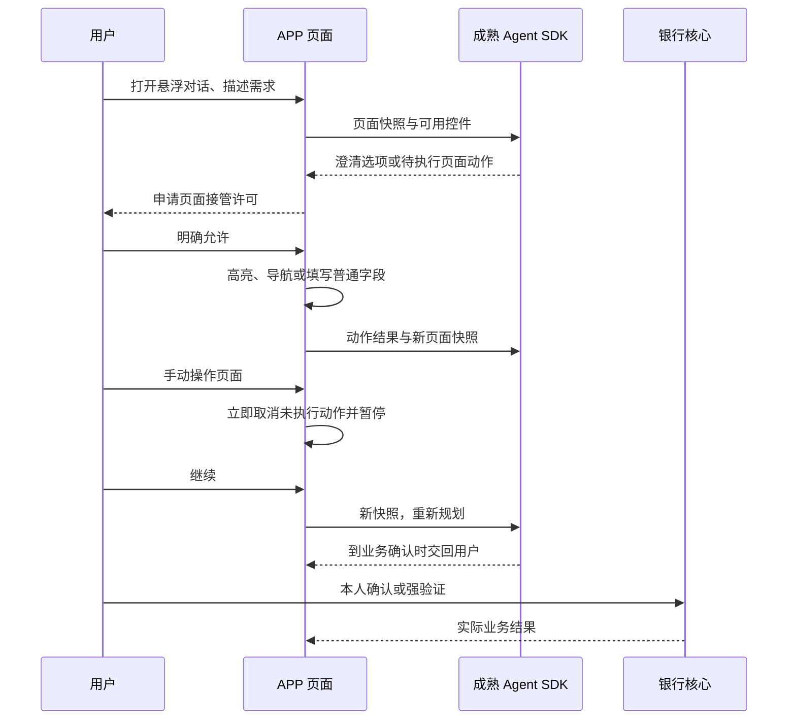

# 可见页面 Agent 原型

当前范围是 PWA 主银行页面（首页、明细、卡片、模拟理财）及业务弹窗。底栏 AI 助手打开完整会话页；许可后的页面代操作露出业务页并显示单条进度。模拟理财增加只读产品检索，测评答案、日期推进、确认和验证码仍由本人操作。独立的 `/security`、`/channels`、`/audit` 等路由尚未接入页面助手。不是原生手机系统级接管，也不承诺操作任意网站或完成尚未实现的业务。2026-10-22 这批改动尚未发布，见 [模拟理财](SIMULATED_INVESTMENTS.md)。

## 复用与自研边界

不重写通用 Agent。`createDeepAgent` 提供模型调用循环、上下文管理、标准 SKILL.md 加载；LangGraph 提供 checkpoint 与工具执行中断，PostgresSaver 提供持久化。团队代码负责把用户当前页面接入这些能力，以及银行产品自己的规则。

| 能力 | 来源 |
| --- | --- |
| 工具调用循环、上下文整理、Skills 发现与按需读取 | Deep Agents 官方 SDK |
| checkpoint、interrupt / resume | LangGraph / PostgresSaver |
| 当前页面快照、脱敏和注册控件 | BankPilot 页面适配 |
| 真实页面导航、逐字填表、助手光标、动作高亮和步骤条 | BankPilot React 页面与客户端执行器 |
| 用户许可、干预暂停、恢复重新观察 | BankPilot 控制权协议 |
| 会话归属、同源校验、步数与调用上限、审计 | BankPilot 服务端 |
| 金额、权限等级、草稿、最终确认、强验证和记账 | 现有 Bank Core；已知缺陷见 ROADMAP |

Codex 可以复用：官方提供开源 CLI、SDK、app-server，app-server 面向嵌入其他产品的会话、事件流、中断与工具接入。Claude Agent SDK 也提供 Claude Code 的运行循环、上下文、权限与会话能力；公开的 Claude Code 仓库不是完整运行时的开源许可声明，其 LICENSE 使用商业条款。

本原型选择 Deep Agents 的工程理由是沿用现有 TypeScript、LangGraph/PostgreSQL 中断持久化、现有 Chat Completions 兼容模型配置。这个理由不代表它的能力优于 Codex 或 Claude，也不是拒绝复用它们的理由。迁移到另一基座需要验证：当前模型接口兼容性、会话隔离与恢复、工具白名单能否强制收敛、用户干预中断时是否取消旧动作。现有页面协议与银行边界可继续复用。

参考：[Deep Agents](https://docs.langchain.com/oss/javascript/deepagents/overview)、[Skills](https://docs.langchain.com/oss/javascript/deepagents/skills)、[Codex 平台说明](https://developers.openai.com/blog/codex-as-a-platform)、[Codex app-server](https://learn.chatgpt.com/docs/app-server)、[Claude Agent SDK](https://code.claude.com/docs/en/agent-sdk/overview)、[Claude Code LICENSE](https://github.com/anthropics/claude-code/blob/main/LICENSE.md)。

## 执行链路



页面接管许可只授权导航、普通字段填写和准备草稿。不会代点最终确认，也不等于黄色确认或红色强验证。选择题有 2～4 个选项、无默认选择，并支持自由输入；回答只补充任务信息。

工具仅有 `inspect_page`、`click_control`、`fill_control`、`scroll_page`、`ask_user`、`handoff_to_user`，以及读取三个固定 Skill 文件的 `read_file`。没有 Shell、SQL、任意网络、任意 JS、动态选择器或记账工具。官方 SDK 的默认文件写入、执行、搜索与子 Agent 工具同时在 profile 和独立 middleware 白名单中限制。

快照剔除密码、验证码、标记为私密的数据及助手自身对话。点击使用当前页面注册的控件 ID；执行前检查页面版本与控制权，550ms 可见高亮期间用户干预会撤销这次点击。助手光标指向真实控件，普通文本字段逐字更新；每个字符写入前校验控制权和页面版本。暂停保留已填内容，不再写入剩余字符。下拉选择一次更新，减少运动模式跳过逐字动画。

真实鼠标、触摸、键盘、粘贴/自动填充等输入、滚轮、失焦/切后台触发暂停；助手主动派发的输入事件不会触发用户接管。恢复提交当前页面重新规划，不重放旧动作；对与原任务冲突的手动修改先询问如何处理。刷新页面后不会自动恢复控制权。

步骤条展示实际收到的动作及本地观察的结果，区分待执行、正在执行、已完成、已暂停、已阻止和等待用户。没有虚构计划总步数，也不把页面动作完成等同于银行业务完成。步骤条本次打开期间保存在客户端；服务端决策与控制日志仍持久化，刷新后当前版本不重建完整历史步骤条。

运行绑定客户和当前登录会话，20 分钟过期，最多 64 步，SDK 每次推进最多 8 次模型调用、每线程最多 40 次。每客户每 5 分钟最多新建 10 次任务，各登录会话共用该额度。同一任务写操作通过 PostgreSQL advisory lock 串行化。SDK 内部允许最多 4 个任务并发，以支持同时读取多个 Skill；多个页面动作中断会整体拒绝，不交给前端执行。日志记录工具动作类型、动作编号、规划状态、客户端回报结果及控制权变化，不保存模型隐藏推理；客户端回报明确标记不可信，不能当作银行执行证明。

## 运行与迁移

Node.js 22+，按 README 配置数据库、PASSWORD_PEPPER、AI_BASE_URL / AI_API_KEY / AI_MODEL。模型必须实际支持 Chat Completions 工具调用；仅通过配置检查不代表兼容性验收。

DeepSeek 官方接口使用 `ChatDeepSeek` 适配器。页面工具调用显式关闭 thinking：当前适配器不会把 `reasoning_content` 完整回传，直接沿用服务端默认 thinking 会导致连续工具调用失败。关闭 thinking 不改变工具白名单、模型调用循环或业务权限。其他兼容接口继续使用 `ChatOpenAI`。

```bash
npm install
npm run db:migrate
npm run dev
```

已有数据库需要执行 `010_visible_app_agent.sql`；compose 初始化目录仅处理新数据库。LangGraph checkpoint schema 由现有 004 迁移创建，PostgresSaver 初始化 checkpoint 表。部署前应在隔离环境验证迁移与真实模型工具调用。

## 验证范围与复现

2026-10-10 本分支验证：41 项 Vitest（包含全部 11 项数据库集成检查）通过，5 项 Chrome 浏览器交互检查通过。SDK 测试使用真实 Deep Agents 调用循环和真实 PostgreSQL checkpoint，但模型传输是确定性测试替身；浏览器检查使用 API 测试替身或预设演示流程，执行器与 React 页面是真实代码。没有把它们计为真实模型任务完成率。

```bash
npm test
# 默认跳过数据库测试；下面必须使用应用过全部迁移的独立测试库：
BANKPILOT_DB_TESTS=1 DATABASE_URL=postgresql://bankpilot_test@127.0.0.1:5432/bankpilot_test PASSWORD_PEPPER=test-only npm test
npx playwright install chromium
npm run test:e2e
# 已有 Chrome 可跳过下载，例如 macOS：
CHROME_PATH='/Applications/Google Chrome.app/Contents/MacOS/Google Chrome' npm run test:e2e
npm run lint
npm run build
```

测试证明：没有页面许可时拒绝推进；跨客户/跨登录会话及过期任务拒绝；旧 actionId 拒绝；暂停后必须带新快照恢复；并发写拒绝；客户级新任务限频；密码与验证码不出现在快照；human 控件不能代点；用户干预会阻止高亮中的点击；选择题自由回答不会获得页面控制权。

新增动画检查：逐字输入进真实字段、途中暂停保留用户内容、自己的输入不触发错误暂停、减少运动时一次填写、React 受控表单更新、修改后恢复先澄清、演示不调用银行 API。

2026-10-10 发布后在 `https://bank.jung.edu.pl` 使用独立零余额测试账户和线上 deepseek-v4-flash 完成真实流程：许可后导航卡片页、打开申请表、逐字填写；手动改名后立即暂停；恢复重新观察并提供选择题；保留手动名称后收起对话，停在本人确认申请。检查期间开卡、入金、转账提交请求为 0，生产预览路由返回 404。该流程是冒烟检查，不代表全场景任务完成率。部署代码提交：`a5581806a9c3b7f46d0fbf3f40acedcd84534f44`。

## 手动交互验证

用户验收应打开正式银行 APP 首页并使用悬浮助手，连接真实模型和银行页面。`/preview/agent` 仅在开发环境保留，生产环境返回 404；它用于复现动画与暂停，不作为产品验收入口。

重点观察：允许后对话缩小，光标/高亮和步骤条随真实动作更新；逐字填写期间点击或粘贴内容会暂停；继续会查看新页面并询问保留修改还是按原计划填写；最终确认按钮由用户点击。正式银行 APP 使用相同助手组件与页面执行器，仍连接实际 SDK 接口。交互预览通过不等于真实模型或银行核心安全验收通过。

## 已知限制

- 已通过 SSH 在不导出生产密钥的情况下，用线上 deepseek-v4-flash 验证真实 SDK 的 Skill 读取、页面动作中断及继续后交回用户。该冒烟检查不代表任务完成率、注入鲁棒性、延迟与成本的系统评测。
- 真正卡片挂失/解挂、理财申赎等缺失业务没有因为页面接管而自动获得。本版明确区分普通锁卡与挂失。
- 日累计提交校验已在先前版本修复；TOTP 时间步消费、客户级失败冷却、转账授权绑定和草稿期限已随 `2a56ca3` 上线，数据库与浏览器回归在 CI 中通过。换绑/恢复未实现。见 [授权补强](AUTHORIZATION_HARDENING.md)。
- 业务工作流已使用确定性服务端事实回执；页面助手结束语统一引导查看银行回执，但追问和动作描述仍由模型生成。客户端页面和回传快照均不可信，不能把页面动作或模型描述当作银行业务成功。
- 只有注册到页面适配器的控件可操作，不具备任意 APP 功能。异步银行请求可能超过快照等待时间，模型必须重新观察，不能推测成功。
- SDK checkpoint 保存必要对话和页面快照，包含银行数据；审计不写明文 OTP 不等于 checkpoint 无个人数据。生产需完善保留期限、访问隔离与加密策略。
- 当前依赖审计仍有已知漏洞。Deep Agents 的 fast-glob / micromatch / braces 链涉及 GHSA-vfj7-8cjw-p6xm，尚无当前版本修复；本版禁用模型可调用的 glob / grep / ls 并只允许读取固定 Skill 路径，降低可达性，但不宣称依赖无漏洞。仓库原有依赖问题另见整体安全自评。
