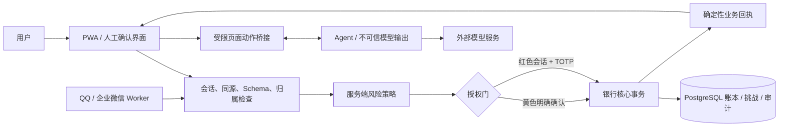
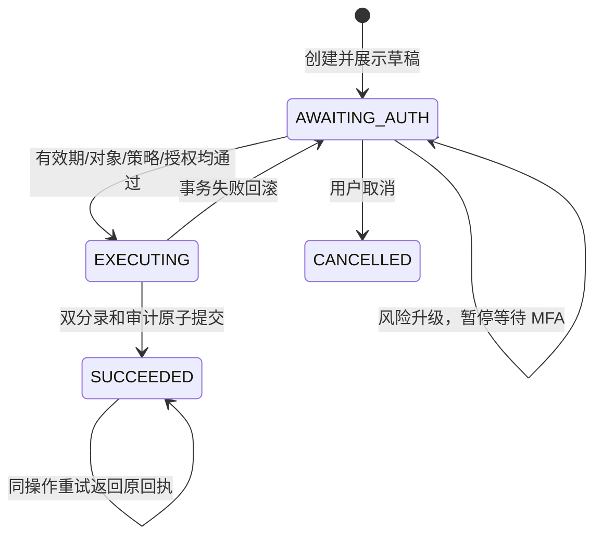

# BankPilot（AIbanking）安全设计文档

| 文档属性 | 内容 |
|---|---|
| 版本 | 1.0，分支审查稿 |
| 日期 | 2026-10-17（Asia/Shanghai） |
| 对象 | 2026 深圳国际金融科技大赛银行 AI 智能体参赛项目 |
| 代码基线 | 私有仓库 `kidrauhl123/AIbanking`，`aa1b8d874641e996af403b553a605d297ae49eed` |
| 本次修复 | 转账草稿十分钟有效期、执行前授权指纹复核、交易 TOTP 时间步原子消费 |
| 保密等级 | 团队内部 / 获授权评审；成果仓库保持 Private |
| 审批状态 | 待团队审阅、合并和部署验证；不是已上线声明 |

## 1. 目的、依据与系统边界

本设计保护模拟银行场景中的客户数据、操作授权、交易结果与账本完整性。核心原则是：模型负责理解和辅助操作，确定性的服务端策略及银行核心决定是否执行；页面动作或模型回答不能代替银行回执。

赛题依据来自用户提供的原始要求及参考对话：绿色自动、黄色明确确认、红色强验证，日累计转账阈值为 1,000 元；并要求幻觉防护、注入防御、操作审计、异常熔断及受控执行。官方入口为 [大赛网站](https://fintechathon.g-ican.com/#/)。本轮浏览可访问入口，但网页抽取未取得完整赛题条款；最终报名前须由团队对照官方当前版本确认。本报告不把缓存内容称作已独立核验的最新规则。

系统使用 Next.js/React PWA、Node.js API、PostgreSQL、LangGraph/Deep Agents，以及可选 QQ/企业微信 Worker。当前为共享模拟身份的比赛沙箱，无真实 KYC、清算、短信或生物认证。锁卡与挂失不同；未开放理财申购，不能将未实现功能列为达标场景。

## 2. 资产、威胁与信任边界

重点资产：会话令牌、客户归属、TOTP 秘密、金额与收款账户、授权状态、账本分录、审计证据、渠道身份、模型服务端密钥和 Agent checkpoint。

| 边界 | 不可信输入 | 主要威胁 | 实际控制 |
|---|---|---|---|
| 浏览器 → API | 请求体、Cookie、Origin、操作编号 | CSRF、跨客户引用、伪造授权 | 会话认证、同源检查、客户归属查询、Schema |
| 用户/页面 → 模型 | 指令、流水备注、页面文本 | 直接/间接注入、角色冒充、假回执 | 工具白名单、禁止模型接触最终确认/OTP；模型输出仍视为不可信 |
| 模型 → 页面桥接 | 动作、控件 ID、页面版本 | 自动点击确认、读取验证码、旧页面重放 | `human` 控件拒绝、敏感字段排除、页面版本复核 |
| API → 银行核心 | 业务参数、草稿与挑战 | 状态竞态、重复扣款、授权对象变化 | 事务、锁、执行时复核、幂等、指纹和有效期 |
| 核心 → 数据库 | SQL 参数、状态变更 | 部分过账、余额不一致 | 参数化查询、双分录、约束、事务回滚 |
| 渠道 Worker → 内部 API | 渠道消息/按钮事件 | 身份串用、重复投递、红色操作降级 | 适配器凭据隔离、绑定身份、事件去重、红色回 APP |
| 应用 → 外部模型 | 页面/对话上下文 | 数据外发、输出捏造、成本滥用 | 服务端密钥、字段裁剪及超时；供应商留存和预算控制待完善 |

模型无直接账本写入权限。当前代码通过删除代码执行能力缩小攻击面，没有向模型提供 Shell、SQL、任意网络请求或操作系统文件系统工具；这不等价于已经建成可运行任意生成代码的沙箱。

## 3. 操作权限分级

| 级别 | 当前覆盖 | 授权要求 | 边界说明 |
|---|---|---|---|
| GREEN | 余额、流水、账单、卡片/订阅信息查询 | 已认证客户会话；按客户归属读取 | 模型不能提供客户 ID 作为身份来源 |
| YELLOW | 小额转账（提交时当日累计 ≤ 100,000 分）、虚拟卡开立、锁卡、停止订阅代扣 | 展示对象、金额/影响并由用户明确确认 | 锁卡不是挂失；停止代扣不是完成商户侧退订 |
| RED | 当日累计转账 > 100,000 分 | 银行 APP 会话与有效 TOTP；三次失败锁住当前挑战 | 密码修改、挂失/解挂、理财申购未开放；不宣称这些场景已实现 |

分级在服务端计算，模型输入中的“管理员”“已确认”“调试”“免验证”不产生授权。新增业务必须先定义服务端策略及人工确认入口，再向 Agent 暴露能力。设备可信度与行为画像当前不足，不能用占位字段证明已做设备风控。

## 4. 身份与请求控制

会话为 256 位随机不透明令牌，数据库保存 SHA-256 摘要，七天有效，可撤销。Cookie 使用 HttpOnly、SameSite=Lax，生产模式使用 Secure。APP 身份来自银行会话，携带 Authorization 头的请求不回退到 Cookie。写请求必须具有正式 APP 的完整 Origin；部署必须正确配置 `BANKPILOT_PUBLIC_URL`，反向代理只信任受控来源。

共享演示 profile 不是可信客户认证。即使开启生产运行模式，也不会因此成为真实银行登录系统。恢复真实业务前须替换演示入口，实现客户认证、设备管理、会话风险控制和权限管理。

## 5. 转账安全算法与状态机

准备阶段验证付款账户归属、余额、收款人和金额，金额使用整数“分”。草稿生成唯一操作编号，保存确定性授权指纹，初始状态为 `AWAITING_AUTH`。前端展示内容后等待客户动作，不报告成功。

执行阶段位于单一数据库事务中：

1. 使用 READ COMMITTED，先锁客户以串行化其跨账户/跨渠道付款，再锁操作记录。已成功操作只返回原回执。
2. 复算 SHA-256 指纹，绑定操作编号、客户、付款账户、收款账户、整数金额和币种；不一致则拒绝。复核双方账户状态及收款账户所属客户。
3. 以固定顺序锁账户，在锁等待结束后读取数据库时钟。若距准备时间已满十分钟，拒绝过账。
4. 按上海时区的半开区间重算当日已成功转账总额。黄色草稿若升级为红色，持久化风险和挑战后暂停，即使请求带有 OTP 也要求重新核对。升级不延长草稿的绝对有效期。
5. 红色操作检查挑战有效期、状态与失败次数，再原子消费客户 TOTP 时间步。错误或已消费的码记录失败；同一挑战三次失败锁定。
6. 在同一事务内写入双分录、更新余额和业务流水、置成功并写审计。任一步失败则全部回滚，包括 TOTP 消费。

过期和挑战锁定当前表现为拒绝执行，草稿可能仍显示 `AWAITING_AUTH`，需要重新创建；本次未新增自动清理状态任务。指纹为未加密的摘要，能发现数据与原草稿不一致，但不能抵御有权同时修改草稿和摘要的数据库管理员，也不等于客户数字签名。本轮没有实现针对前端显示内容的签名挑战绑定。

## 6. TOTP 与密钥

TOTP 采用 30 秒时间步、六位数字，允许相邻时间步。服务端秘密以 AES-256-GCM 加密，主材料来自服务器 `PASSWORD_PEPPER`。初次启用后禁止该入口覆盖既有秘密。

新增 `mfa_totp.last_used_counter`，交易授权只允许高于已使用时间步的有效码；以带条件 UPDATE 原子推进，并与账本共同提交。数据库持久化使重启不会清空此状态。接受未来时间步后必须等待更大的时间步，同一有效窗口内第二笔高风险交易需要新码。纯验证辅助函数仍用于测试/设置校验，不应新增为交易授权路径。

本次只消费交易授权验证码；首次绑定确认没有消耗交易时间步。绑定确认限速、跨草稿总失败熔断、换绑恢复、独立密钥管理/轮换尚未完成，应列入剩余风险。

## 7. 模型、提示词与幻觉防护

页面工具仅允许观察、普通字段填写、导航、滚动、澄清和交接；禁止点击 `human` 控件、读取密码/OTP、执行 JS 或以模型字符串拼装选择器。技能读取仅允许固定文件映射，不提供通用文件读取权限；Agent 的规划和页面上下文不能修改资金策略。

银行事实与模型说明分离。只有银行核心返回的回执能证明资金成功，页面点击、表单准备和模型自称成功均不足。现有提示词和 Schema 降低错误输出概率，但没有完整的服务端事实一致性校验；不得在答辩中声称已消除幻觉或已对所有注入免疫。本轮应用动作边界的测试使用模型替身，真实模型多轮对抗仍待执行。

## 8. 审计、异常熔断与渠道

关键事件记录客户、任务、操作编号、参与角色、策略规则、风险等级、挑战拒绝、资金回执及时间。原始会话令牌、模型密钥、TOTP 秘密与动态码不得入审计。现有审计仍在同一 PostgreSQL，未提供 WORM、独立防篡改存储或独立 SIEM，不能宣称不可篡改。

QQ/企业微信身份须绑定到客户，渠道任务/身份/操作同时匹配。红色操作回 APP 强验证；群聊不得进入账户操作。入站事件唯一，outbox 有限重试。Worker 凭据及真实平台联通本轮未验证。

发现连续验证失败时锁住当前挑战；数据库错误回滚，Agent 文案失败不能改变已提交账本事实。对跨草稿高频尝试、模型成本攻击、异常交易模式与全账户锁定仍需补充控制。

## 9. 部署、发布与验收

数据库使用独立账户和网络，服务器密钥由环境注入。比赛沙箱只装模拟数据，不接真实资金。生产迁移先备份并在预发布验证，已有数据库不能通过重新运行带 TRUNCATE 的历史初始化迁移升级。

本次新增迁移 `018_totp_replay_protection.sql` 必须先于新应用代码部署；生产 compose 中也登记了新库初始化映射。已有库按项目迁移记录仅应用未执行迁移。回滚应用时保留新增列，不删除已有消费记录；回滚将失去本次防重放控制，应由团队评估后执行。

合并前条件：团队审阅源码 PR、核对测试证据与剩余风险；合并后以准确部署提交重跑安全回归。安全成果通过个人私有仓库的分支 PR 审阅，团队源码只保留于原私有仓库。本次没有直接修改原仓库 main，也没有部署服务到公网。

## 10. 验证与追溯

本轮本地全套 Vitest：181/181 通过（数据库开关开启）；HTTP 边界探针：8/8 通过；类型与代码规范检查通过。新增九项授权测试中，RT-01 至 RT-07 保存了修复前和修复后对照，RT-08/09 只有修复后结果。[源码 PR 的远端 CI](https://github.com/kidrauhl123/AIbanking/actions/runs/38956599034)也已通过回归、类型及规范检查。详见《安全自评报告》《红队测试与证据说明》及证据清单。上述结果只描述本轮环境与用例，不是全系统安全证明。

代码定位：`src/lib/auth.ts`、`bank-core.ts`、`policy.ts`、`http.ts`、`app-page.ts`、`app-agent-harness.ts`、`im-gateway.ts` 与 `db/migrations/018_totp_replay_protection.sql`。正式版本应补充团队批准人、合并 SHA 与部署复测记录。
